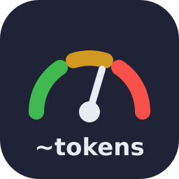

<p align="center">
  
</p>

# estimar-tokens

[Português](#português) · [English](#english)

## Português

Plugin do [Claude Code](https://claude.com/claude-code) que estima quantos tokens e quantos **dólares** cada etapa de uma tarefa vai gastar, e compara com o **saldo real** dos seus limites de uso, **antes** de executar. Assim a sessão não para no meio de uma tarefa por limite.

### O que ele faz

- **Lê o saldo real.** Mostra o percentual usado dos limites de 5 horas e de 7 dias e o tamanho do contexto, a partir dos dados que o Claude Code envia à status line.
- **Estima cada etapa em tokens e em US$** pelo modelo `chamadas × contexto atual + acréscimos`, com custos **medidos no seu próprio histórico** e preços por modelo da API.
- **Mostra o custo real** de uma sessão ou de um período (com os subagentes), por modelo, em tokens e US$.
- **Exporta em Markdown** a estimativa e o custo real, para guardar, comparar ou anexar num PR.
- **Quebra a tarefa em etapas seguras**, que terminam com algo concluído (commit, PR, pacote enviado), sem estado público pela metade.
- **Decide pelo saldo:**
  - avisa o custo antes de cada etapa;
  - pede confirmação nas etapas caras;
  - não começa o que não cabe e propõe continuar depois da renovação do limite.
- **Gasta menos**: saídas filtradas, leitura parcial, poucos subagentes e menos chamadas.

### Instalação

No Claude Code 2.1.275 ou mais novo, dentro de uma sessão:

```
/plugin install estimar-tokens --marketplace britors/estimar-tokens
```

Em versões anteriores:

```
/plugin marketplace add britors/estimar-tokens
/plugin install estimar-tokens@estimar-tokens
```

Pela linha de comando:

```bash
claude plugin marketplace add britors/estimar-tokens
claude plugin install estimar-tokens@estimar-tokens
```

Para atualizar: `/plugin marketplace update estimar-tokens`.

**Manual, só a skill**, sem o sistema de plugins e sem o hook:

```bash
git clone https://github.com/britors/estimar-tokens.git ~/src/estimar-tokens
mkdir -p ~/.claude/skills
ln -s ~/src/estimar-tokens/skills/estimar-tokens ~/.claude/skills/estimar-tokens
```

### Configurar o saldo real (recomendado)

Sem este passo, a skill só estima. Com ele, ela sabe quanto do limite já foi usado.

Em `~/.claude/settings.json`, aponte a status line para o script do plugin. Instalado como plugin, ele fica em `~/.claude/plugins/marketplaces/estimar-tokens/skills/estimar-tokens/scripts/statusline.py`:

```json
{
  "statusLine": {
    "type": "command",
    "command": "python3 ~/.claude/plugins/marketplaces/estimar-tokens/skills/estimar-tokens/scripts/statusline.py"
  }
}
```

Para manter a status line que você já usa, passe o comando dela em `--encadear`:

```json
"command": "python3 .../statusline.py --encadear 'bash ~/.claude/minha-statusline.sh'"
```

A barra mostra algo como `minha linha | 5h 42% · 7d 71% · ctx 13%`, e o retrato vai para `~/.claude/estimar-tokens/saldo.json`.

Os limites só aparecem para assinantes do Claude.ai, ou atrás de um gateway com limite de gasto. Pela API sem gateway, a status line mostra só o contexto.

### Calibrar com o seu histórico

```bash
python3 .../scripts/calibrar.py --salvar
```

O script lê `~/.claude/projects/**/*.jsonl` e mede quanto cada ferramenta acrescenta ao contexto (mediana e p90), quanto custa um subagente e o contexto típico das suas sessões. Ele grava o resultado em `~/.claude/estimar-tokens/custos-medidos.md`, e a skill passa a usar essa tabela no lugar da padrão.

Opções:

- `--dias N`: janela, padrão de 30 dias;
- `--projeto TRECHO`: só um projeto.

Nada sai da sua máquina.

### Custo em dólar e relatórios em Markdown

**Estimativa de uma tarefa**, etapa por etapa, no formato `descrição|chamadas|tokens novos em mil`:

```bash
python3 .../scripts/estimar.py \
  --etapa "Ler o código|4|8" --etapa "Corrigir e testar|8|15" --etapa "Commit e PR|3|3" \
  --titulo "Corrigir bug #42" --md estimativa.md
```

| # | Etapa | Chamadas | Tokens novos | Tokens processados | Custo |
| ---: | --- | ---: | ---: | ---: | ---: |
| 1 | Ler o código | 4 | 8,0 mil | 865,4 mil | US$ 0,26 |
| 2 | Corrigir e testar | 8 | 15,0 mil | 1.793,9 mil | US$ 0,53 |
| 3 | Commit e PR | 3 | 3,0 mil | 715,1 mil | US$ 0,18 |
| | **Total** | **15** | **26,0 mil** | **3.374,4 mil** | **US$ 0,97** |

**Custo real** da sessão atual, com os subagentes:

```bash
python3 .../scripts/custo_real.py --ultimos-min 60 --md custo.md   # ou --desde "2026-11-10 09:00", --sessao <id>
```

O custo real separa entrada, escrita e leitura do cache e saída, por modelo.

Os preços ficam em `references/precos.json`, que traz a tabela da API Anthropic com os multiplicadores de cache. Para usar outros valores, crie `~/.claude/estimar-tokens/precos.json` no mesmo formato.

Para assinantes do Claude.ai, o valor em dólar é o **equivalente em API**, não uma cobrança: serve para comparar tarefas e entender o que pesa.

Também dá para pedir direto ao Claude: "exporta a estimativa em MD" ou "quanto custou essa tarefa? salva em MD".

### Lembrete a cada pedido (opcional)

O plugin traz um hook que lembra o Claude de estimar a cada pedido, com o saldo atual. Ele vem **desligado**: sem o arquivo de ativação, o hook não imprime nada nem gasta tokens.

```bash
mkdir -p ~/.claude/estimar-tokens
touch ~/.claude/estimar-tokens/lembrete   # liga (cerca de 60 tokens por pedido)
rm ~/.claude/estimar-tokens/lembrete      # desliga
```

### Uso

O Claude carrega a skill sozinho antes de tarefas com vários passos. Para chamar direto:

- instalada como plugin: `/estimar-tokens:estimar-tokens`;
- instalada manualmente: `/estimar-tokens`.

Para que ela valha sempre sem o hook, acrescente ao `CLAUDE.md`:

```markdown
Antes de cada operação, siga a skill `estimar-tokens`.
```

### Estrutura

```
.claude-plugin/          marketplace.json, plugin.json, ícone
hooks/                   lembrete opcional (UserPromptSubmit)
skills/estimar-tokens/
  SKILL.md               passos: saldo → tabela → estimativa → decisão
  references/custos.md   tabela padrão
  scripts/
    statusline.py        mostra e grava o saldo
    saldo.py             lê o último saldo
    calibrar.py          mede custos no histórico
    estimar.py           etapas → tokens e US$ (--md)
    custo_real.py        custo real da sessão (--md)
  references/precos.json preços por modelo
```

Requer Python 3.8 ou mais novo, só com a biblioteca padrão.

## English

[Claude Code](https://claude.com/claude-code) plugin that estimates how many tokens — and how many dollars — each step of a task will use and checks it against your **real usage limits**, **before** running it, so a session doesn't stop halfway because of a usage limit.

- **Real balance:** the bundled status line script (`scripts/statusline.py`) shows and records the 5-hour and 7-day limit usage and context size that Claude Code sends to the status line. Use `--encadear '<cmd>'` to keep your current status line.
- **Measured costs:** `scripts/calibrar.py --salvar` measures per-tool cost from your own `~/.claude/projects` transcripts. Everything stays local.
- **Safe steps:** work is split into steps that end in a consistent state. Expensive steps need confirmation, and steps that don't fit the remaining quota aren't started.
- **Cost in USD and Markdown export:** `scripts/estimar.py` (estimate per step) and `scripts/custo_real.py` (real cost of a session, including subagents) print tables in tokens and USD; `--md file.md` saves them.
- **Optional reminder hook:** off by default. Turn it on with `touch ~/.claude/estimar-tokens/lembrete`.

Install:

```
/plugin install estimar-tokens --marketplace britors/estimar-tokens
```

On older versions, run `/plugin marketplace add britors/estimar-tokens` and then `/plugin install estimar-tokens@estimar-tokens`.

The skill text is in Brazilian Portuguese, and Claude follows it in any language.

## Licença / License

GPL-3.0. Veja / see [LICENSE](LICENSE).
